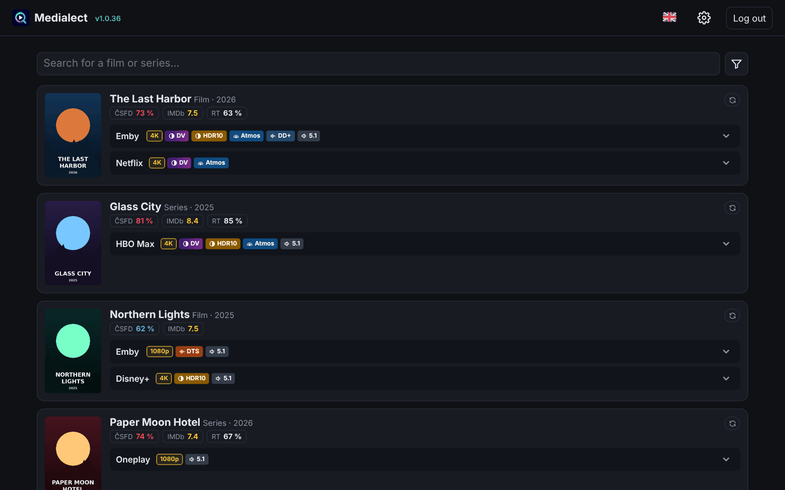
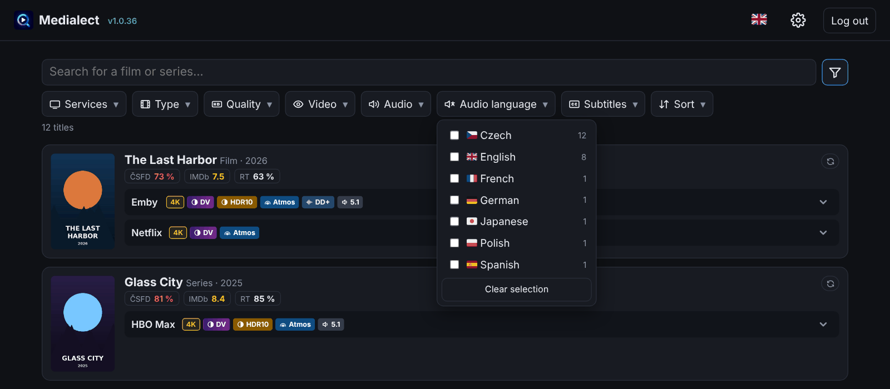
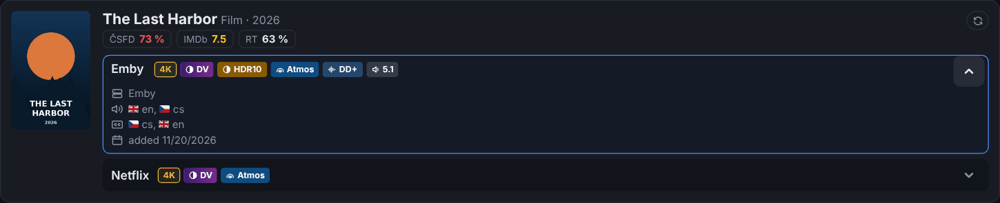
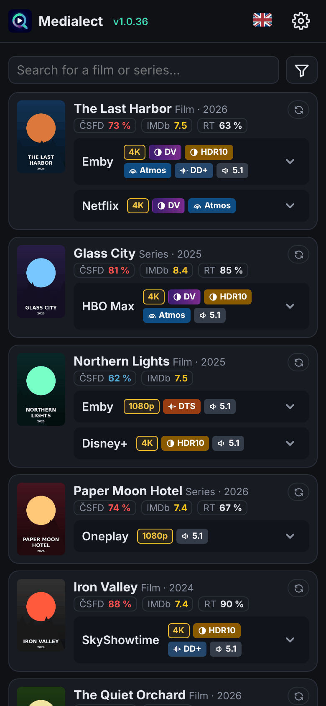
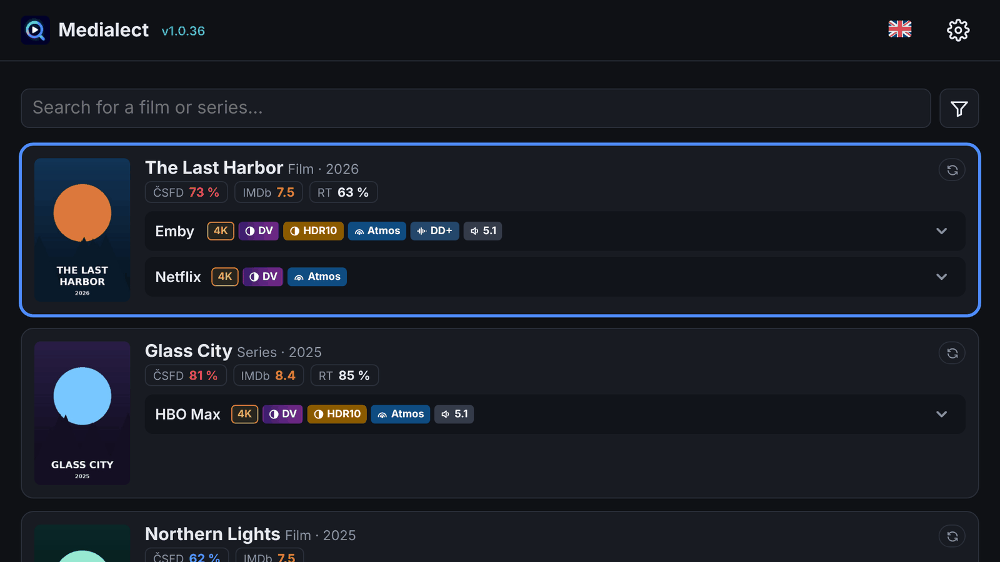
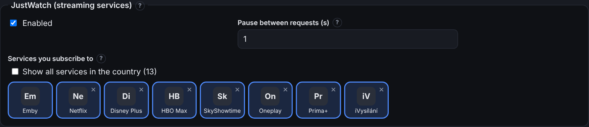
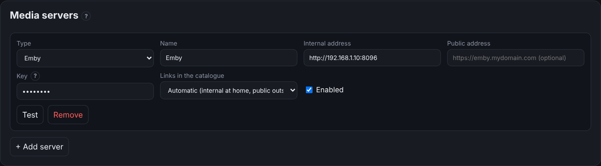
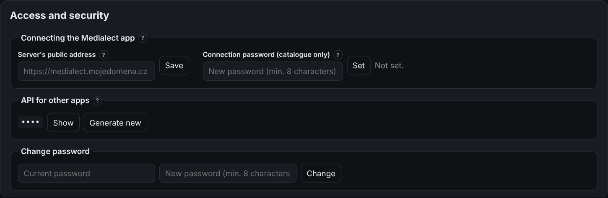

# Medialect

**Where can I watch it?** Medialect shows every film and series you can watch – on the streaming
services you pay for (Netflix, Disney+, HBO Max, SkyShowtime, Oneplay, Prima+…), on Czech Television's
free iVysílání and on your own media server at home (Emby, Jellyfin, Plex) – in one list.

For every title it tells you **where** it is, **in what quality** (4K, Dolby Vision, HDR, Dolby Atmos…),
**in which languages** (audio and subtitles) and **how good it is** (ratings from ČSFD, IMDb, Rotten
Tomatoes and more). One tap starts it in the right app.



<sub>The screenshots use made-up titles, posters and ratings.</sub>

## Download

| What | For | Link |
|---|---|---|
| **Android app** | phone, tablet, Google TV, Android TV | [⬇ Medialect-android.apk](https://github.com/tlkounev/Medialect/releases/latest/download/Medialect-android.apk) |
| **Server (Docker)** | a NAS (QNAP, Synology…) or any computer that runs Docker | [⬇ docker-compose.yml](https://raw.githubusercontent.com/tlkounev/Medialect/main/docker-compose.yml) · image [`ghcr.io/tlkounev/medialect`](https://github.com/tlkounev/Medialect/pkgs/container/medialect) |

**Which one do I need?**

- **Just the app** – install the Android app and choose *On its own*. The app downloads the catalogue
  by itself. Nothing else is needed.
- **Server + app** – run the server at home. It keeps the catalogue up to date for the whole
  household, you open it in any web browser, and the apps on phones and TVs simply connect to it.

## What it can do

- **One list for everything** – streaming services, iVysílání and your own Emby / Jellyfin / Plex
  libraries. The services you have come first, in the order you choose.
- **Picture and sound at a glance** – 4K / 1080p, Dolby Vision, HDR10, HDR10+, Dolby Atmos, DTS,
  TrueHD, 5.1…
- **Languages** – which audio tracks and subtitles each service has, with flags.
- **Ratings** – ČSFD, IMDb, Rotten Tomatoes, TMDB, TVmaze; with a free MDBList key also Metacritic,
  Letterboxd and Trakt.
- **Play** – tapping a service opens the title in that service's app (or in the browser).
- **Search** – Czech or original names, with or without diacritics.
- **Filters** – service, film / series, quality, picture, sound, audio language, subtitles. Sort by
  title, release year, rating or what was added recently.
- **Refresh button** on every title – loads that one title again from all sources, right now.
- **Google TV / Android TV** – made for the remote control.
- **28 languages** of the interface (the flag in the top bar).

### Filters



### Details of an offer

The arrow on the right shows the audio languages, subtitles and when the title was added.



### Phone and TV

<p>
  
  &nbsp;
  
</p>

## Installing the Android app

1. On the phone, open
   [Medialect-android.apk](https://github.com/tlkounev/Medialect/releases/latest/download/Medialect-android.apk).
2. Open the downloaded file. Android asks whether to allow installing apps from this source – allow it
   (only once).
3. Start Medialect and choose:
   - **On its own** – the app downloads the data itself, or
   - **With a Medialect server** – enter your server's address and password.

**Google TV / Android TV** has no normal web browser. The easiest way: install the free
**Downloader** app from Google Play, open it, type the address of the APK above and install it.
(Downloader may ask for permission to install apps – allow it.)

**Updates:** when a new version is out, the app tells you. Tap *Update*, the new APK downloads in the
browser and you install it the same way.

## Installing the server (Docker)

You need a device that runs **Docker** – most NAS boxes can (QNAP *Container Station*,
Synology *Container Manager*), or any computer with Docker Desktop.

### QNAP Container Station (Synology is similar)

1. Open **Container Station** → **Applications** → **Create**.
2. Name it `medialect`.
3. Paste the content of
   [docker-compose.yml](https://raw.githubusercontent.com/tlkounev/Medialect/main/docker-compose.yml)
   and press **Create**.
4. In a browser open `http://<your-NAS-address>:8890` (for example `http://192.168.1.10:8890`).

### Any computer with Docker

Download [docker-compose.yml](https://raw.githubusercontent.com/tlkounev/Medialect/main/docker-compose.yml)
into an empty folder and run in that folder:

```bash
docker compose up -d
```

Then open `http://localhost:8890`.

### Automatic updates

The `docker-compose.yml` also starts **Watchtower**. Once an hour it checks for a new version of
Medialect and updates it by itself. The current version is shown next to the logo.

Your data (catalogue, settings, password) is kept in the `medialect-data` volume, so it survives
updates.

## First start

1. **Choose a password.** It protects the settings and the catalogue.
2. A short guide (3 steps) follows:
   - **Country and language** – the catalogues of streaming services differ by country.
   - **Your services** – tap the ones you pay for. Drag a tile to change their order.
   - **Ratings** – IMDb and TVmaze are free; ČSFD can be switched on.
3. **Finish and start syncing.** The first download takes tens of minutes. The catalogue fills in
   while you wait and the progress is shown in the corner.

Everything can be changed later under the gear icon (**Settings**).



### Your own media server (Emby, Jellyfin, Plex)

*Settings → Media servers → + Add server.* Fill in:

- **Internal address** – how the server is reached at home, for example `http://192.168.1.10:8096`.
- **Public address** (optional) – how it is reached from outside, for example
  `https://emby.example.com`. The *Play* links use it when you are away from home.
- **Key**:
  - **Emby** – Dashboard → Advanced → API Keys → *+ New Api Key*.
  - **Jellyfin** – Dashboard → API Keys → *+*.
  - **Plex** – in Plex Web open any title → ⋯ → *Get Info* → *View XML*; the token is in the address
    of the page that opens, after `X-Plex-Token=`.

Press **Test**, then **Save server**. If Emby has a ČSFD plugin, Medialect takes the ČSFD page of each
title from it.



### Ratings and extra sources (optional)

All in *Settings*. The free keys only add more:

| Source | What it adds | Where to get it |
|---|---|---|
| **JustWatch** | the catalogues of the streaming services | nothing – free, no key |
| **IMDb**, **TVmaze** | IMDb ratings, series ratings | nothing – free, no key |
| **ČSFD** | ČSFD ratings | nothing – just switch it on |
| **TMDB** | TMDB ratings | free key at [themoviedb.org](https://www.themoviedb.org/settings/api) |
| **OMDb** | Rotten Tomatoes, Metacritic | free key at [omdbapi.com](https://www.omdbapi.com/apikey.aspx) |
| **MDBList** | Rotten Tomatoes, Metacritic, Letterboxd, Trakt | free key at [mdblist.com](https://mdblist.com/preferences/) |
| **Streaming Availability** | links straight to the title, the date it was added | key at [movieofthenight.com](https://www.movieofthenight.com/about/api) (free tier) |

## Away from home and for the family



- **Away from home:** make the server reachable from the internet over **HTTPS** (for example through
  the reverse proxy of your router or NAS) and enter that address under *Settings → Access and
  security → Server's public address*. The apps then use the home address at home and the public one
  elsewhere. Nobody gets in without a password.
- **Family:** set a **connection password**. Whoever connects with it sees the catalogue but cannot
  open the settings. Your admin password opens everything.

## For developers

- `app/` – the server (Python, FastAPI, SQLite). Tests: `python tests/run_tests.py` (against fake
  services, no internet needed).
- `client/` – the Android app (Tauri 2): the same interface (`app/static`) and the server's logic in
  TypeScript (`client/src/core`), so the app also works without a server. Tests: `cd client && npm test`.
- Every merge to `main` that touches the app releases a new app version (`app-v0.1.x`). The Docker
  image is built by the *Docker* workflow (versions `1.0.x`, tags `1.0.x` and `latest`, amd64 and
  arm64).

### API

Every request needs a login, for example the API key from *Settings → Access and security* in the
header `X-Api-Key` (or `?api_key=`).

| Endpoint | What it does |
|---|---|
| `GET /api/catalog?q=matrix&provider=netflix&min_quality=UHD&video=DV&audio=Atmos&lang=cs&sort=csfd` | the catalogue with search, filters and sorting |
| `GET /api/search?q=matrix&type=movie` | quick search |
| `GET /api/titles/{id}` | one title |
| `GET /api/titles/by/imdb/tt0133093` | a title by its ID (`imdb`, `tmdb_movie`, `tmdb_tv`, `tvdb`, `csfd`) |
| `POST /api/titles/{id}/refresh` | load one title again from all sources |
| `GET /api/providers` | services and libraries with the number of titles |
| `POST /api/sync[?job=justwatch]` | start a synchronisation (admin) |
| `GET /api/sync/status` | progress of the synchronisation (admin) |
| `GET/PUT /api/settings` | settings (admin) |

Each offer in `where[]` has `provider`, `quality` (`SD/HD/FHD/QHD/UHD`), `video`, `audio`,
`audio_langs`, `subtitle_langs`, `url`, and for libraries `extra.item_id` / `extra.rating_key`.

## Good to know

- Medialect is not connected with JustWatch, ČSFD, IMDb or any streaming service. It reads what they
  publish, for your own personal use.
- Flags: [Twemoji](https://github.com/jdecked/twemoji) (CC-BY 4.0), see `app/static/fonts/`.
